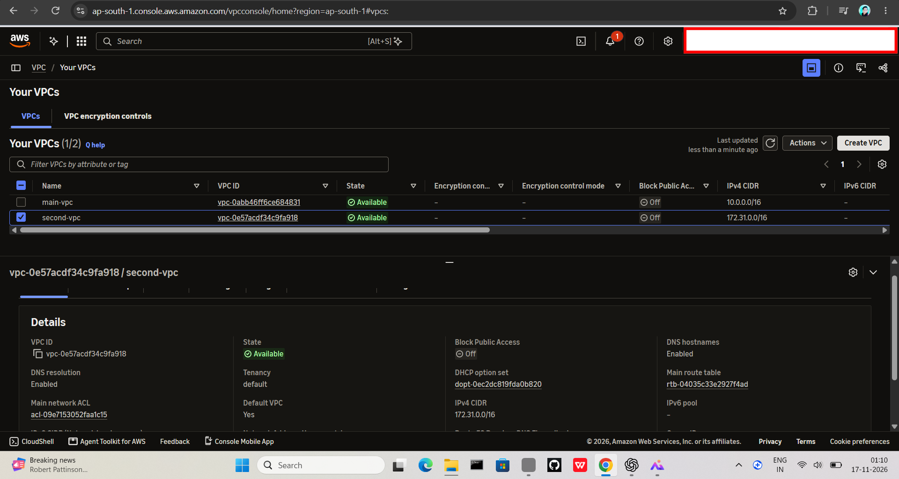
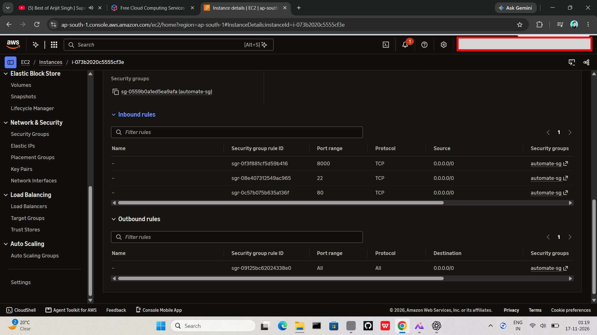
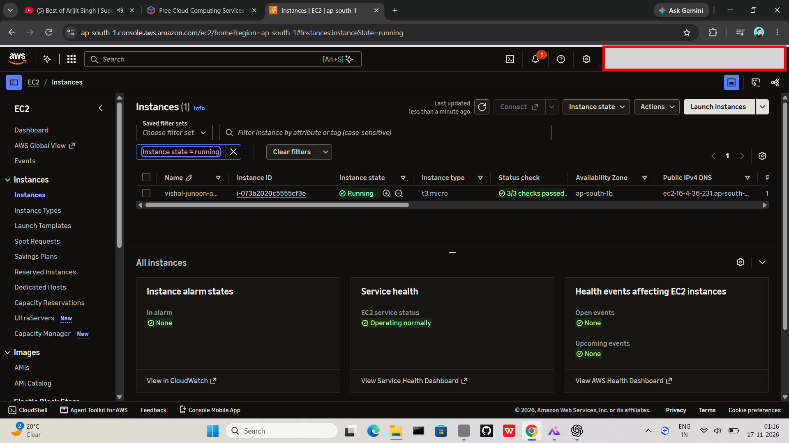
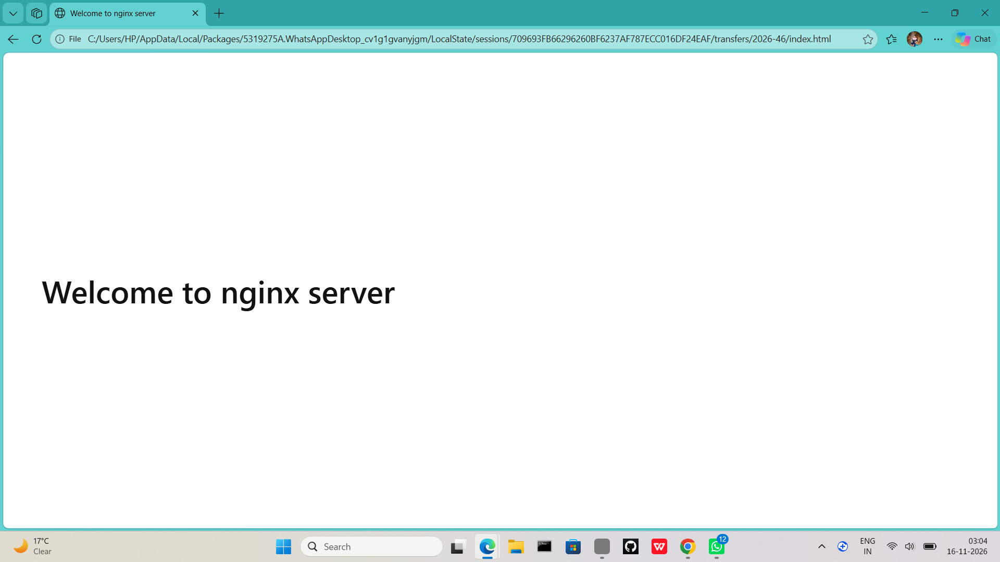
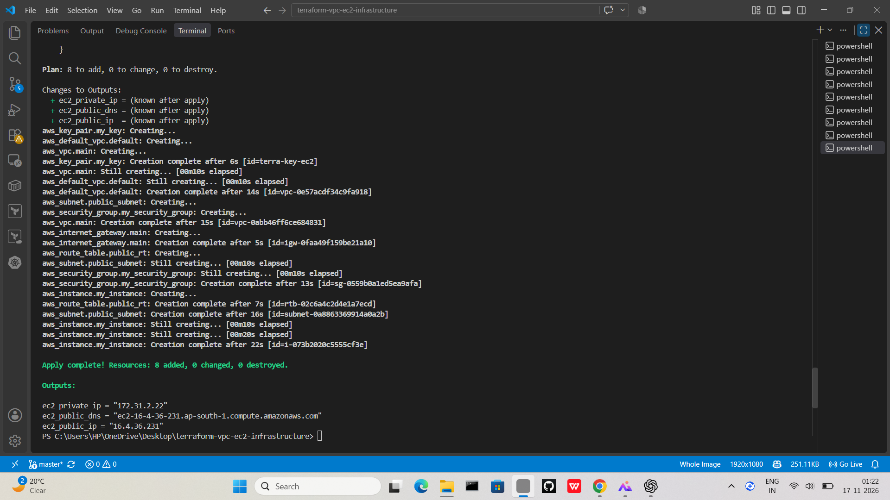

# Terraform-Based AWS VPC and EC2 Infrastructure

### Infrastructure as Code (IaC) Project using Terraform and AWS


\


---

## 1. Project Overview

This project demonstrates how to design and deploy AWS cloud infrastructure using Terraform (Infrastructure as Code).

The infrastructure includes a custom AWS VPC, public and private subnets, Internet Gateway, Route Tables, Security Groups, and an EC2 instance.

An Nginx web server is configured on the EC2 instance to host a web page accessible through its public IP address.

The main objective is to automate AWS infrastructure provisioning using Terraform instead of manually creating resources through the AWS Management Console.

---

## 2. Project Objectives

- Automate AWS infrastructure using Terraform.
- Create a custom Virtual Private Cloud (VPC).
- Configure public and private subnets.
- Set up Internet Gateway and Route Tables.
- Configure Security Groups for network access.
- Deploy an EC2 instance.
- Install and configure Nginx automatically.
- Access the hosted website through a browser.

---

## 3. Technologies Used

| Technology       | Purpose                   |
| ---------------- | ------------------------- |
| AWS              | Cloud Infrastructure      |
| Terraform        | Infrastructure Automation |
| EC2              | Virtual Server            |
| VPC              | Network Isolation         |
| Subnets          | Network Segmentation      |
| Internet Gateway | Internet Connectivity     |
| Security Groups  | Network Security          |
| Linux            | Server Operating System   |
| Nginx            | Web Server                |
| VS Code          | Code Editor               |
| Git & GitHub     | Version Control           |

---

## 4. Architecture Diagram

The project follows this infrastructure design:

```text
              Internet
                  |
          Internet Gateway
                  |
              AWS VPC
                  |
          Public Route Table
                  |
             Public Subnet
                  |
             Security Group
                  |
              EC2 Instance
                  |
              Nginx Server
                  |
             Hosted Website

              Private Subnet
              (Private Network)
```

---

## 5. Project Screenshots

### AWS Infrastructure

\<table> \<tr> \<td width="50%"> \<b>1. VPC Configuration\</b>\<br> \ \</td> \<td width="50%"> \<b>2. Subnets Configuration\</b>\<br> \ \</td> \</tr> \<tr> \<td width="50%"> \<b>3. Internet Gateway\</b>\<br> \ \</td> \<td width="50%"> \<b>4. Route Table\</b>\<br> \ \</td> \</tr> \<tr> \<td width="50%"> \<b>5. Security Group\</b>\<br> \ \</td> \<td width="50%"> \<b>6. EC2 Instance\</b>\<br> \ \</td> \</tr> \</table>

### Deployment and Web Server

\<table> \<tr> \<td width="50%"> \<b>7. Terraform Apply Output\</b>\<br> \ \</td> \<td width="50%"> \<b>8. Nginx Website\</b>\<br> \ \</td> \</tr> \<tr> \<td width="50%"> \<b>9. Project Structure\</b>\<br> \ \</td> \<td width="50%"> \<b>10. EC2 Public IP\</b>\<br> \ \</td> \</tr> \</table>

---

## 6. Project Folder Structure

```text
terraform-vpc-ec2/
│
├── images/
│   ├── vpc.png
│   ├── subnets.png
│   ├── internet-gateway.png
│   ├── route-table.png
│   ├── security-group.png
│   ├── ec2-instance.png
│   ├── public-ip.png
│   ├── nginx-website.png
│   ├── terraform-apply.png
│   └── project-structure.png
│
├── provider.tf
├── variables.tf
├── terraform.tfvars.example
├── vpc.tf
├── subnet.tf
├── internet-gateway.tf
├── route-table.tf
├── security-group.tf
├── ec2.tf
├── outputs.tf
├── nginx.sh
├── .gitignore
└── README.md
```

---

## 7. Infrastructure Components

### VPC

Created a custom Virtual Private Cloud to provide an isolated networking environment.

### Public Subnet

Configured a public subnet to deploy the EC2 instance with internet connectivity.

### Private Subnet

Created a private subnet for network segmentation and future private workloads.

### Internet Gateway

Attached an Internet Gateway to the VPC to enable internet communication.

### Route Table

Configured routing rules to direct internet-bound traffic through the Internet Gateway.

### Security Group

Configured inbound rules to control access to the EC2 instance.

### EC2 Instance

Launched an EC2 virtual server to host the Nginx web server.

### Nginx

Installed and configured Nginx using an initialization script (`nginx.sh`).

---

## 8. How to Deploy This Project

### Prerequisites

Before starting, make sure you have:

- AWS Account
- Terraform installed
- AWS CLI installed
- VS Code
- Git installed
- AWS credentials configured

### Step 1: Clone Repository

```bash
git clone YOUR_GITHUB_REPOSITORY_URL
```

### Step 2: Navigate to Project

```bash
cd terraform-vpc-ec2
```

### Step 3: Configure AWS Credentials

```bash
aws configure
```

Enter your AWS Access Key, Secret Key and default region.

### Step 4: Initialize Terraform

```bash
terraform init
```

### Step 5: Validate Configuration

```bash
terraform validate
```

### Step 6: Format Terraform Files

```bash
terraform fmt
```

### Step 7: Review Execution Plan

```bash
terraform plan
```

### Step 8: Apply Infrastructure

```bash
terraform apply
```

Type `yes` when prompted.

### Step 9: Access Nginx Website

After successful deployment, copy the EC2 public IP address and open:

```text
http://YOUR_EC2_PUBLIC_IP
```

---

## 9. Terraform Commands

| Command            | Description                    |
| ------------------ | ------------------------------ |
| terraform init     | Initialize Terraform           |
| terraform fmt      | Format configuration files     |
| terraform validate | Validate configuration         |
| terraform plan     | Preview infrastructure changes |
| terraform apply    | Deploy AWS infrastructure      |
| terraform output   | Display outputs                |
| terraform destroy  | Delete created infrastructure  |

---

## 10. Security Best Practices

- Never upload AWS Access Keys or Secret Keys to GitHub.
- Never upload your actual `terraform.tfvars` file.
- Use `terraform.tfvars.example` as a configuration template.
- Restrict SSH access to your own IP address.
- Allow HTTP traffic only when required.
- Use IAM permissions following the principle of least privilege.
- Review AWS resources before deployment.

---

## 11. Challenges & Learning Outcomes

Through this project, I learned:

- AWS VPC networking fundamentals.
- Terraform configuration and resource management.
- Infrastructure as Code implementation.
- AWS EC2 provisioning.
- Linux server administration.
- Nginx installation and configuration.
- Network security and Security Group management.
- Troubleshooting infrastructure deployment issues.
- Managing project code using Git and GitHub.

---

## 12. Future Improvements

- Add Application Load Balancer.
- Configure Auto Scaling Groups.
- Implement NAT Gateway for private subnet internet access.
- Add CloudWatch monitoring.
- Implement CI/CD using GitHub Actions.
- Improve infrastructure security.

---

## 13. Author

**Vishal Pawar**

Aspiring Cloud & DevOps Engineer

Skills: AWS | Terraform | Linux | Networking | Docker | Git & GitHub

---

## 14. Disclaimer

This project is created for educational and hands-on cloud engineering practice.

AWS resources may incur charges. Review your infrastructure and billing before deployment.

---

⭐ If you find this project useful, feel free to explore the repository!
